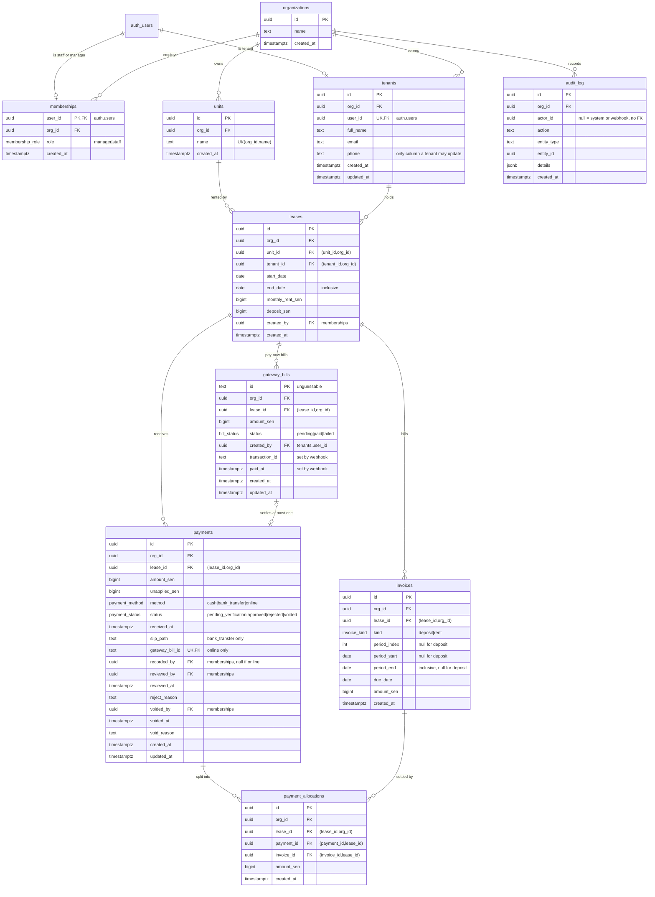

# Database design

Design reference. Migration 1 (`supabase/migrations/*_schema.sql`) implements it. This file is the reference the migrations,
`schema.prisma` and the seed are written from. **`ASSESSMENT.md` overrides
`AGENTS.md` / `docs/adr/` wherever they conflict.** Known deltas this design
needs from the scaffold docs (to fix in a later task, with a superseding ADR):

- Unit is **sen**, not cents. Source of truth is **Supabase SQL migrations**;
  `schema.prisma` is hand-written to match (ADR 0013 superseded).
- AGENTS section 5 says `paid_cents` is stored on the invoice. The brief says the
  paid amount is the **sum of allocations** and status is **never stored**. No
  `paid` column here.
- AGENTS section 8 says never hard-delete financial records. The brief says a
  void **removes the payment's allocations**. Allocation rows are the one
  deliberate exception (see 7.2). Payments, invoices, leases, audit rows are never
  deleted.
- Roles come from `memberships` + `tenants.user_id`. No `profiles` table.

Conventions for every table: `id uuid` default `gen_random_uuid()` (except
`gateway_bills.id`), `org_id` NOT NULL, money `bigint` sen, calendar dates `date`,
instants `timestamptz`, native Postgres enums, `ON DELETE RESTRICT` on every FK.
Business timezone is the constant `Asia/Kuala_Lumpur`; no timezone column.

---

## 1. Critique of the draft

Verdict per table, against `ASSESSMENT.md`. "Gap" = would fail a hidden test or
an instant-fail rule if left as drafted. "Hardening" = correct but weaker than
it should be for a money system.

| #   | Table / area             | Finding                                                                                                                                                                                                                                           | Kind      | Change                                                                                                                  |
| --- | ------------------------ | ------------------------------------------------------------------------------------------------------------------------------------------------------------------------------------------------------------------------------------------------- | --------- | ----------------------------------------------------------------------------------------------------------------------- |
| 1   | `payments`               | One `reviewed_by/reviewed_at/reason` set. A **void** (approved -> voided) overwrites the approver and the approval time. Reject reason and void reason are different facts.                                                                       | Gap       | Split: `reviewed_*` + `reject_reason`, and `voided_by/voided_at/void_reason`.                                           |
| 2   | `payments`               | `unapplied_sen` has no rule. Brief: only **online** payments may have it; a voided/pending/rejected payment cannot hold credit.                                                                                                                   | Gap       | CHECKs tie `unapplied_sen` to `method` and `status` (section 5.1).                                                      |
| 3   | `payments`               | Nothing ties `method` to `gateway_bill_id`, `slip_path`, `recorded_by`. Online payment with a slip, or bank transfer without one, is representable.                                                                                               | Gap       | CHECKs: online <=> `gateway_bill_id`; bank_transfer <=> `slip_path`.                                                    |
| 4   | `payments.slip_path`     | Brief: slip must point to an **existing file in its own org's folder**. Draft has no rule.                                                                                                                                                        | Gap       | CHECK prefix `<org_id>/` and no `..`; trigger confirms the object exists in `storage.objects`.                          |
| 5   | `payment_allocations`    | Draft has `lease_id` but no rule tying it. A payment on lease A could allocate to an invoice on lease B (same org passes the org check).                                                                                                          | Gap       | FKs `(payment_id, lease_id)` and `(invoice_id, lease_id)`: cross-lease allocation is unrepresentable.                   |
| 6   | `payment_allocations`    | Nothing stops over-allocating an invoice (two racing approvals) or allocations not summing to the payment.                                                                                                                                        | Gap       | Deferred constraint triggers (5.2). App takes the lease lock; the DB is the last line.                                  |
| 7   | `payment_allocations`    | Void must "remove" allocations, but nothing says how or guards stray deletes.                                                                                                                                                                     | Gap       | Delete-only-when-parent-voided trigger; allocation snapshot goes in `audit_log.details` (7.2).                          |
| 8   | `invoices`               | No shape CHECKs: a `deposit` with a period, a `rent` with no period, `due_date != period_start`, duplicate `(lease, period_index)`, two deposits.                                                                                                 | Gap       | CHECKs + partial unique indexes (5.1, 5.3).                                                                             |
| 9   | `invoices` / `leases`    | Mutable by anyone with owner access. A changed `amount_sen` silently rewrites history.                                                                                                                                                            | Hardening | Immutable-columns trigger on `leases`, `invoices`, `payment_allocations`, and key `payments` columns.                   |
| 10  | `leases`                 | Exclusion constraint is right and is the only race-proof answer to "even when two requests arrive at the same moment". Missing `end_date >= start_date`, rent `> 0`, deposit `>= 0`, composite FKs `(unit_id, org_id)` and `(tenant_id, org_id)`. | Gap       | Added. Composite FKs make "lease on another org's unit/tenant" fail in the DB too.                                      |
| 11  | `gateway_bills`          | `id TEXT unguessable` is right, but nothing enforces unguessable-ness shape, and `paid` is not terminal ("a paid bill never goes back").                                                                                                          | Gap       | Format CHECK on `id`; status state-machine trigger (paid is terminal).                                                  |
| 12  | `gateway_bills`/payment  | Webhook: "a bill creates at most one payment, ever". `UNIQUE(payments.gateway_bill_id)` is right; but the payment could point at a bill of another lease or with another amount.                                                                  | Hardening | Composite FK `(gateway_bill_id, lease_id, amount_sen)` -> `gateway_bills`.                                              |
| 13  | `gateway_bills`          | Draft lacks `transaction_id`/`paid_at` rules. Settled bill without `paid_at` cannot produce `received_at`.                                                                                                                                        | Gap       | CHECK: `status = paid` => `paid_at` NOT NULL.                                                                           |
| 14  | `audit_log`              | Append-only "for everyone incl. service role and owner" is correct. A plain `REVOKE` does not bind the owner or service role; a trigger does. `session_replication_role = replica` bypasses ordinary triggers.                                    | Gap       | BEFORE UPDATE/DELETE trigger + BEFORE TRUNCATE trigger, both `ENABLE ALWAYS`.                                           |
| 15  | `audit_log`              | Brief does not require logging recording or online settlement. Decided (Q2/Q3): audit exactly lease.created, payment.approved (also immediate approval), payment.rejected, payment.voided. Exact rows may be counted, so no extras.               | Decided   | Four actions only; no `payment.recorded`, no `payment.settled_online`.                                                  |
| 16  | `memberships`/`tenants`  | A user in both tables makes role resolution ambiguous. Decided (Q7): no exclusivity trigger.                                                                                                                                                      | Decided   | Service layer resolves the role in one helper: `memberships` first, then `tenants`. The seed never puts a user in both. |
| 17  | actor columns            | `recorded_by`, `reviewed_by`, `created_by`: draft is silent on FKs.                                                                                                                                                                               | Hardening | FK to `memberships` / `tenants(user_id)`, not `auth.users` (trade-off 7.3).                                             |
| 18  | Report                   | Group by month **in Malaysia time**. Grouping by UTC puts the seeded RM 2,000 (2026-03-01 00:30 MYT = 2026-02-28 16:30Z) in February. Brief's own Part B sample has this bug.                                                                     | Gap       | Range-scan on `received_at` using `+08` month bounds; partial index (section 4).                                        |
| 19  | Whole draft              | Missing: `created_at`/`updated_at`, FK-supporting indexes, grants/RLS plan, and what must be Postgres enums.                                                                                                                                      | Gap       | Sections 2, 3, 4.                                                                                                       |
| 20  | `invoices` no `paid`     | **Correct.** Derive paid from allocations, status from `invoiceStatus()`.                                                                                                                                                                         | OK        | Keep.                                                                                                                   |
| 21  | `memberships` PK         | **Correct.** `user_id` PK = "exactly one organization".                                                                                                                                                                                           | OK        | Add `UNIQUE(user_id, org_id)` so other tables can FK the pair.                                                          |
| 22  | `tenants.user_id` UNIQUE | **Correct.** Decided (Q4): NOT NULL.                                                                                                                                                                                                              | OK        | `user_id uuid NOT NULL UNIQUE`.                                                                                         |

Things in the draft that were right and stay: composite `(x_id, org_id)` FKs,
bigint sen, `date` vs `timestamptz`, no stored status, `RESTRICT`, CHECKs, no
overlap via exclusion constraint, append-only audit.

---

## 2. ER diagram

Every table carries `org_id`. Edges from `organizations` are drawn only to the
roots to keep the picture readable; the others reach `organizations` through
composite FKs `(x_id, org_id)`.



Enums: `membership_role (manager, staff)`, `invoice_kind (deposit, rent)` **in that
order** (so `ORDER BY kind` already means "deposit before rent"),
`payment_method (cash, bank_transfer, online)`,
`payment_status (pending_verification, approved, rejected, voided)`,
`bill_status (pending, paid, failed)`.

### Composite keys needed for the composite FKs

| Table                        | Extra unique (target of an FK) |
| ---------------------------- | ------------------------------ |
| `memberships`                | `(user_id, org_id)`            |
| `units`, `tenants`, `leases` | `(id, org_id)`                 |
| `invoices`, `payments`       | `(id, lease_id)`               |
| `gateway_bills`              | `(id, lease_id, amount_sen)`   |
| `tenants`                    | `(user_id)` (already unique)   |

---

## 3. Column rules (beyond the diagram)

- **`payments`**: `amount_sen > 0`. `received_at` is the instant the money was
  received (online: the webhook `paid_at`). `recorded_by` NULL only for `online`.
  `gateway_bill_id` FK is composite `(gateway_bill_id, lease_id, amount_sen)` so a
  payment can only point at a bill of its own lease with exactly its amount; it is
  skipped (MATCH SIMPLE) for manual payments where the column is NULL.
- **`gateway_bills.id`**: server-generated `bill_` + 32+ chars of base64url from a
  CSPRNG. Never sequential, never derived from lease/amount. Webhook looks it up by
  primary key.
- **`audit_log.details`**: always includes the before/after `status`, `amount_sen`, `lease_id`, and per-action extras (`reason` on reject/void, allocation snapshot on void). Never a raw webhook payload, never a secret.
- **`updated_at`** only on tables that mutate (`tenants`, `payments`,
  `gateway_bills`), maintained by trigger.
- **Phone**: nullable, CHECK on length and character class (digits, `+`, space,
  `-`, parentheses). Validation message lives in the zod schema.

---

## 4. Requirement -> schema traceability

Rows that lean on a trigger from 5.2 marked "migration 3, later" are enforced by the service layer
until that migration exists.

`DB` = enforced by the database (survives any bug in app code). `App` = enforced
in service code under the lease lock; a test must prove it.

### Section 1 - Business and roles

| Rule                                                    | Where                                                                                                                                 | By     |
| ------------------------------------------------------- | ------------------------------------------------------------------------------------------------------------------------------------- | ------ |
| Org rents units under leases                            | `organizations`, `units`, `leases` with composite FKs                                                                                 | DB     |
| Lease -> optional deposit + one rent invoice per period | `invoices.kind`; partial unique (one deposit per lease); `deposit_sen > 0` <=> deposit invoice exists is created in the same tx (5.3) | DB+App |
| Money in sen, integers                                  | every amount `bigint`; `> 0` / `>= 0` CHECKs; upper bound CHECK (Q6)                                                                  | DB     |
| Malaysia time everywhere                                | `date` for calendar facts, `timestamptz` for instants; month bucketing by `+08` bounds; no `timestamp without time zone` anywhere     | DB+App |
| Staff/manager belong to exactly one org                 | `memberships.user_id` PRIMARY KEY                                                                                                     | DB     |
| Nobody sees another org's data                          | composite FKs (no cross-org reference possible) + RLS on reads + service-layer org check                                              | DB+App |
| Roles from `memberships` / `tenants.user_id`            | the only role sources; one resolver helper (memberships first, then tenants; no exclusivity trigger, Q7); never `user_metadata`       | DB+App |
| Manager: create leases, approve/reject/void, read audit | App role check; Data API: `audit_log` SELECT policy requires `role = manager` in own org                                              | App+DB |
| Staff: read, record payments (pending)                  | App sets `status` from role; `payments` CHECK: reviewed fields NULL while pending                                                     | App+DB |
| Tenant: read own, update own phone, pay online          | RLS "own lease" predicate; column-level `GRANT UPDATE (phone)` on `tenants` + RLS on own row                                          | DB     |

### Section 4 - Payments

| Rule                                                             | Where                                                                                                                                                         | By     |
| ---------------------------------------------------------------- | ------------------------------------------------------------------------------------------------------------------------------------------------------------- | ------ |
| Record cash / bank transfer with amount, method, received_at     | `payments` columns; `method`, `received_at` immutable after insert                                                                                            | DB     |
| Bank transfer needs a slip (JPEG/PNG/PDF, <= 5 MB) in Storage    | CHECK `bank_transfer` <=> `slip_path`; type/size enforced by the bucket config (`allowed_mime_types`, `file_size_limit`) **and** in the route                 | DB+App |
| Slip failure cleanup: no orphan file                             | App: record in a tx; on failure remove the object. Optional janitor lists objects with no payment                                                             | App    |
| `slip_path` in own org's folder and exists                       | CHECK `slip_path` starts with `<org_id>/`, contains no `..`; BEFORE INSERT trigger checks a row in `storage.objects` for bucket `payment-slips` and that name | DB     |
| Manager-recorded => approved immediately; staff => pending       | App; CHECKs make `approved` require `reviewed_by/at`, `pending_verification` forbid them                                                                      | App+DB |
| Cap: amount <= remaining balance - sum(pending)                  | App, inside the **lease row lock** (5.4). Not expressible as a CHECK                                                                                          | App    |
| Approve: re-check remaining balance, refuse and stay pending     | App under the same lock; transition guarded by `UPDATE ... WHERE status = 'pending_verification'` (0 rows = 409)                                              | App+DB |
| Reject needs reason >= 5 chars                                   | CHECK `status = rejected` => `char_length(btrim(reject_reason)) >= 5`                                                                                         | DB     |
| Void approved only, reason >= 5                                  | CHECK `status = voided` => voided_* NOT NULL, `char_length(btrim(void_reason)) >= 5`; state-machine trigger allows only approved -> voided                    | DB     |
| Void removes only that payment's allocations                     | Allocations are keyed by `payment_id`; delete trigger only allows deleting rows of a `voided` payment; no other payment's rows are touched                    | DB+App |
| Payments never deleted                                           | No DELETE grant; BEFORE DELETE trigger on `payments` raises                                                                                                   | DB     |
| Audit row for approval, rejection, void, lease creation          | Same transaction as the action (all-or-nothing). `audit_log` insert is the last statement; failure rolls the action back                                      | App    |
| Allocation order: due date, deposit before rent, period index    | Query `ORDER BY due_date, kind, period_index` (enum order). Index `(lease_id, due_date, kind, period_index)`                                                  | App+DB |
| Allocation fills each invoice to its unpaid amount, incl. future | Deferred trigger I1: `SUM(allocations) <= invoices.amount_sen` per invoice                                                                                    | DB     |
| Leftover stored as `unapplied_sen`; only online can have it      | CHECK: `method <> online` => `unapplied_sen = 0`; `status <> approved` => `unapplied_sen = 0`; trigger I2: approved => `SUM(alloc) + unapplied = amount`      | DB     |
| Paid amount = sum of allocations; status computed, never stored  | No `paid`/`status` column on `invoices`; `invoiceStatus()` computes                                                                                           | DB     |
| Concurrent recordings must not exceed the cap together           | `SELECT ... FOR UPDATE` on the lease row first in every record/approve/void/webhook tx                                                                        | App    |
| Same payment approved twice at once allocates once               | Lease lock + `WHERE status = 'pending_verification'` guard + I2 trigger                                                                                       | App+DB |
| Collections report per MYT month, including empty months         | Query `received_at >= month_start+08 AND < next_month+08`, `status = approved`; months generated in app (or `generate_series`), left-joined so empties appear | App    |

### Section 5 - Online payments

| Rule                                                          | Where                                                                                                                                                    | By     |
| ------------------------------------------------------------- | -------------------------------------------------------------------------------------------------------------------------------------------------------- | ------ |
| Bill = unpaid amount of invoices due <= today (MYT); else 422 | App: sum over invoices `due_date <= today_MYT` minus allocations; `gateway_bills.amount_sen > 0`                                                         | App+DB |
| Bill ids impossible to guess                                  | `gateway_bills.id` text, CSPRNG, format CHECK `^bill_[A-Za-z0-9_-]{32,}$`                                                                                | DB     |
| Only the webhook settles a bill                               | App: the return page never writes. DB: tenants have no write grants; only the server (owner/service) writes. `status = paid` requires `paid_at`          | App+DB |
| Bad signature 401, unknown bill 404, amount mismatch 422      | App (verify HMAC on parsed fields before any DB access)                                                                                                  | App    |
| Repeat / concurrent `paid=true` => one payment                | `UNIQUE(payments.gateway_bill_id)` + `UPDATE gateway_bills SET status='paid' WHERE id=$1 AND status<>'paid' RETURNING` (0 rows = replay, 200, no effect) | DB     |
| `received_at = paid_at`; payment approved + allocated         | Payment insert + allocation in the same tx (no audit row for online settlement, Q2) as the bill update, under the lease lock                             | App    |
| `paid=false`: pending -> failed; paid never goes back         | State-machine trigger on `gateway_bills`: `paid` terminal; `failed -> paid` allowed (late success), `failed -> failed` no-op                             | DB     |
| Never log secret key or whole payload                         | App/logging. Nothing stores the raw payload (no `webhook_events` table, 7.4)                                                                             | App    |

### Section 6 - Access control

| Rule                                                          | Where                                                                                                                                                                                                                                                                                | By     |
| ------------------------------------------------------------- | ------------------------------------------------------------------------------------------------------------------------------------------------------------------------------------------------------------------------------------------------------------------------------------ | ------ |
| 401 / 403 / 404 semantics                                     | One `authenticate` + `authorize` helper in the service layer; other-org / other-tenant => 404, visible-but-forbidden => 403                                                                                                                                                          | App    |
| IDs in bodies untrusted (lease on another org's unit/tenant)  | App resolves unit/tenant **within the caller's org** (404). DB backstop: composite FKs `(unit_id, org_id)` and `(tenant_id, org_id)`                                                                                                                                                 | App+DB |
| Data API matrix                                               | `REVOKE ALL ON ALL TABLES/SEQUENCES/FUNCTIONS` from `anon, authenticated, PUBLIC`, **and** `ALTER DEFAULT PRIVILEGES` so future objects start closed; then `GRANT SELECT` per matrix. RLS enabled on every table. No INSERT/UPDATE/DELETE grant except `UPDATE (phone)` on `tenants` | DB     |
| `anon`: nothing                                               | No grant, no policy for `anon` on any table                                                                                                                                                                                                                                          | DB     |
| Tenant reads own org, units of own leases, own tenant row     | Policies via private SECURITY DEFINER helpers (`private.my_tenant_id()`, `private.my_lease_ids()`); `search_path` fixed to empty                                                                                                                                                     | DB     |
| Staff/manager read own org; manager-only `audit_log`          | Policy `org_id = private.my_org_id()`; audit policy adds `role = manager`                                                                                                                                                                                                            | DB     |
| `memberships`: staff/manager read own org; tenants none       | Policy `org_id = private.my_org_id()` (a tenant has no membership => no rows)                                                                                                                                                                                                        | DB     |
| RPC cannot be called                                          | All functions live in `private` (not in the PostgREST exposed schemas); `REVOKE EXECUTE ... FROM PUBLIC, anon, authenticated`; **no views** (they would be exposed)                                                                                                                  | DB     |
| `audit_log` append-only for all, incl. service role and owner | Triggers (5.2) fire for owner and service role; no UPDATE/DELETE/TRUNCATE grants; `ENABLE ALWAYS`                                                                                                                                                                                    | DB     |
| Private bucket `payment-slips`, org folder, signed URLs       | Bucket created in a migration (`public = false`, mime + size limits). Storage policies on `storage.objects`: INSERT and SELECT only when `(storage.foldername(name))[1]` equals the caller's staff/manager `org_id`; no tenant, no anon policy                                       | DB     |
| Service-role key never in browser                             | `SUPABASE_SECRET_KEY` read only in server-only modules; never `NEXT_PUBLIC_`                                                                                                                                                                                                         | App    |

### Section 8 - Database

| Rule                                                      | Where                                                                                                                                                    | By  |
| --------------------------------------------------------- | -------------------------------------------------------------------------------------------------------------------------------------------------------- | --- |
| Everything in `supabase/migrations/`; `db reset` rebuilds | Tables, enums, triggers, functions, grants, policies, bucket and its policies, `btree_gist` extension all in migrations. Nothing in Studio               | DB  |
| Required tables and columns (names are a contract)        | Section 2 uses the brief's names verbatim; extras are only additions                                                                                     | DB  |
| Money bigint sen, dates `date`, instants `timestamptz`    | Conventions above                                                                                                                                        | DB  |
| `schema.prisma` matches the DB                            | Hand-written. CHECKs, exclusion constraint, partial indexes, triggers are invisible to Prisma and documented here instead                                | DB  |
| Leases never overlap (inclusive), even concurrently       | Exclusion constraint on `(unit_id =, daterange(start_date, end_date, '[]') &&)` using `btree_gist`. SQLSTATE `23P01` -> HTTP 409                         | DB  |
| Lease + exactly the generated invoices, all or nothing    | One transaction: lease insert, invoices insert, audit insert. The schedule shape is validated by `generateSchedule` and by the seed numbers in section 6 | App |

---

## 5. Constraints that cannot be drawn

Described as predicates, not SQL.

### 5.1 CHECK constraints

| Table                 | Predicate                                                                                                                                                                                                                                                                                                                                                                                                                                              |
| --------------------- | ------------------------------------------------------------------------------------------------------------------------------------------------------------------------------------------------------------------------------------------------------------------------------------------------------------------------------------------------------------------------------------------------------------------------------------------------------ |
| `leases`              | `end_date >= start_date`; `monthly_rent_sen > 0`; `deposit_sen >= 0`; both amounts `<=` upper bound (Q6); lease length cap is **app validation only**, no DB CHECK (Q5)                                                                                                                                                                                                                                                                                |
| `invoices`            | `amount_sen > 0`. `kind = deposit` => `period_index`, `period_start`, `period_end` all NULL. `kind = rent` => `period_index >= 0`, `period_start` and `period_end` NOT NULL, `period_end >= period_start`, **`due_date = period_start`**                                                                                                                                                                                                               |
| `payments` (amounts)  | `amount_sen > 0`; `0 <= unapplied_sen <= amount_sen`; `method <> online` => `unapplied_sen = 0`; `status <> approved` => `unapplied_sen = 0`                                                                                                                                                                                                                                                                                                           |
| `payments` (method)   | `(method = online) = (gateway_bill_id IS NOT NULL)`; `(method = bank_transfer) = (slip_path IS NOT NULL)`; `method = online` => `recorded_by IS NULL` and `status IN (approved, voided)`; `method <> online` => `recorded_by IS NOT NULL`                                                                                                                                                                                                              |
| `payments` (slip)     | `slip_path` NULL or starts with `org_id                                                                                                                                                                                                                                                                                                                                                                                                                |     | '/'`and has no`..` |
| `payments` (status)   | `pending_verification`: `reviewed_*`, `reject_reason`, `voided_*`, `void_reason` all NULL. `approved`: `reviewed_at` NOT NULL and (`reviewed_by` NOT NULL **or** `method = online`, a system approval), voided\_\* NULL. `rejected`: `reviewed_by/at` NOT NULL and `char_length(btrim(reject_reason)) >= 5`. `voided`: `reviewed_at` NOT NULL (`reviewed_by` too unless online) and `voided_by/at` NOT NULL and `char_length(btrim(void_reason)) >= 5` |
| `payment_allocations` | `amount_sen > 0`                                                                                                                                                                                                                                                                                                                                                                                                                                       |
| `gateway_bills`       | `amount_sen > 0`; `id` matches `^bill_[A-Za-z0-9_-]{32,}$`; `status = paid` => `paid_at IS NOT NULL`                                                                                                                                                                                                                                                                                                                                                   |
| `tenants`             | `phone` NULL or matches the allowed character class, length `<= 20`; `email` non-empty                                                                                                                                                                                                                                                                                                                                                                 |
| `audit_log`           | `action` and `entity_type` non-empty; `details` is a JSON object                                                                                                                                                                                                                                                                                                                                                                                       |

### 5.2 Triggers

| Trigger                                                                       | Table(s)                                                                                                                                                                                                                                               | Rule                                                                                                                                                                                                 |
| ----------------------------------------------------------------------------- | ------------------------------------------------------------------------------------------------------------------------------------------------------------------------------------------------------------------------------------------------------ | ---------------------------------------------------------------------------------------------------------------------------------------------------------------------------------------------------- |
| **Append-only** (migration 2)                                                 | `audit_log`                                                                                                                                                                                                                                            | BEFORE UPDATE, BEFORE DELETE (row) and BEFORE TRUNCATE (statement) always raise. `ENABLE ALWAYS` so `session_replication_role = replica` cannot bypass. No grants besides INSERT to the server role. |
| **Immutable columns** (migration 3, later)                                    | `leases`, `invoices`, `payment_allocations`; `payments` (`amount_sen`, `lease_id`, `org_id`, `method`, `received_at`, `slip_path`, `gateway_bill_id`, `recorded_by`, `created_at`); `gateway_bills` (`amount_sen`, `lease_id`, `org_id`, `created_by`) | BEFORE UPDATE raises if a listed column changes.                                                                                                                                                     |
| **Payment state machine** (migration 3, later)                                | `payments`                                                                                                                                                                                                                                             | Allowed: `pending_verification -> approved`, `pending_verification -> rejected`, `approved -> voided`. `rejected` and `voided` are terminal. Anything else raises.                                   |
| **Bill state machine** (migration 3, later)                                   | `gateway_bills`                                                                                                                                                                                                                                        | Allowed: `pending -> paid`, `pending -> failed`, `failed -> paid`. `paid` is terminal (never back). Same-state update is a no-op, not an error.                                                      |
| **Never delete** (migration 3, later)                                         | `payments`, `invoices`, `leases`, `gateway_bills`                                                                                                                                                                                                      | BEFORE DELETE raises.                                                                                                                                                                                |
| **Allocation delete guard** (migration 3, later)                              | `payment_allocations`                                                                                                                                                                                                                                  | BEFORE DELETE allowed only when the parent payment is `voided` (the void tx updates the payment first, then deletes).                                                                                |
| **I1 invoice not over-allocated** (migration 3, later) (deferred, constraint) | `payment_allocations`                                                                                                                                                                                                                                  | After INSERT: `SUM(amount_sen)` for the invoice `<=` `invoices.amount_sen`.                                                                                                                          |
| **I2 payment fully accounted** (migration 3, later) (deferred, constraint)    | `payments`, `payment_allocations`                                                                                                                                                                                                                      | At commit, per touched payment: `approved` => `SUM(alloc) + unapplied_sen = amount_sen`; any other status => `SUM(alloc) = 0`.                                                                       |
| **Slip exists** (migration 3, later)                                          | `payments`                                                                                                                                                                                                                                             | BEFORE INSERT for `bank_transfer`: a `storage.objects` row exists for bucket `payment-slips` with `name = slip_path`.                                                                                |
| **`updated_at`** (migration 1)                                                | `tenants`, `payments`, `gateway_bills`                                                                                                                                                                                                                 | BEFORE UPDATE sets `updated_at`.                                                                                                                                                                     |

Migration plan: **1** schema (tables, keys, CHECKs, exclusion, indexes, `updated_at`);
**2** security (RLS, grants, Storage bucket and policies, `audit_log` append-only);
**3** optional integrity triggers, only if time allows. Until migration 3 exists, the
rules marked "migration 3, later" are enforced by the service layer under the lease
lock, and the CHECKs/keys in migration 1 are the DB backstop.

All trigger functions live in `private`, are `SECURITY DEFINER` only when they
must read a table the caller cannot (`storage.objects`), always with
`SET search_path = ''`, and have `EXECUTE` revoked from `PUBLIC`, `anon`,
`authenticated`.

### 5.3 Unique and exclusion constraints

| Table                 | Constraint                                                                         | Purpose                                  |
| --------------------- | ---------------------------------------------------------------------------------- | ---------------------------------------- |
| `leases`              | EXCLUDE (`unit_id` =, `daterange(start_date, end_date, '[]')` &&) via `btree_gist` | No overlap, inclusive dates, race-proof  |
| `invoices`            | UNIQUE `(lease_id, period_index)` WHERE `kind = rent`                              | One invoice per period                   |
| `invoices`            | UNIQUE `(lease_id)` WHERE `kind = deposit`                                         | At most one deposit invoice              |
| `payments`            | UNIQUE `(gateway_bill_id)` (NULLs allowed many times)                              | A bill creates at most one payment, ever |
| `payment_allocations` | UNIQUE `(payment_id, invoice_id)`                                                  | One row per pair, no duplicate splits    |
| `units`               | UNIQUE `(org_id, name)`                                                            | Unit names unique per org                |
| `memberships`         | PRIMARY KEY `(user_id)`; UNIQUE `(user_id, org_id)`                                | One org per user; FK target              |
| `tenants`             | UNIQUE `(user_id)`                                                                 | One tenant row per login                 |

Not enforced by the DB (and why): "deposit invoice exists iff `deposit_sen > 0`"
and "invoices equal `generateSchedule(lease)`" are cross-row and cross-language;
they are guaranteed by the single transaction in the lease-creation service and
proven by the seed counts and tests.

### 5.4 Concurrency protocol (not a constraint, but part of the schema contract)

Every transaction that records, approves, rejects, voids or settles an online
payment starts with `SELECT ... FROM leases WHERE id = $1 FOR UPDATE`
(`$queryRaw`; `findUnique` does not lock). Always lock **lease first, then payment,
then bill**. One lock order everywhere means no deadlocks.

- Two staff recording RM 800 and RM 700 on RM 1,000 remaining: second waits on the
  lease lock, recomputes `remaining - pending`, is refused (422).
- Same payment approved twice: loser blocks on the lease lock, then its
  `WHERE status = 'pending_verification'` update touches 0 rows (409). Triggers I1
  and I2 are the backstop if the guard is ever removed.
- Webhook replays: bill `UPDATE ... WHERE status <> 'paid'` is atomic per row;
  the unique `gateway_bill_id` rejects any second payment insert.
- Overlapping leases: the exclusion constraint serialises concurrent inserts for
  the same unit without any app lock.

### 5.5 Indexes

| Index                                                                                                                                                                                                                           | Serves                                      |
| ------------------------------------------------------------------------------------------------------------------------------------------------------------------------------------------------------------------------------- | ------------------------------------------- |
| FK columns that queries, RLS or deletes hit (`org_id`, `tenant_id`, `lease_id`, `invoice_id`; `payment_id` via the `(payment_id, invoice_id)` unique). Actor FKs (`recorded_by` etc.) are unindexed: tiny tables, never deleted | FK checks, RLS joins, cascades-free deletes |
| `leases (tenant_id)`                                                                                                                                                                                                            | Tenant portal and "own lease" RLS helper    |
| `leases (org_id, created_at, id)`                                                                                                                                                                                               | Keyset-paginated lease list (bonus)         |
| `invoices (lease_id, due_date, kind, period_index)`                                                                                                                                                                             | Allocation order scan                       |
| `invoices (org_id, due_date)`                                                                                                                                                                                                   | Dashboard overdue count                     |
| `payment_allocations (invoice_id)`                                                                                                                                                                                              | Paid-per-invoice aggregate                  |
| `payment_allocations (payment_id)`                                                                                                                                                                                              | Void: find the payment's allocations        |
| `payments (lease_id, status)`                                                                                                                                                                                                   | Cap: sum of pending / approved for a lease  |
| `payments (org_id, received_at) INCLUDE (amount_sen) WHERE status = 'approved'`                                                                                                                                                 | Collections report, index-only range scan   |
| `gateway_bills (lease_id)`                                                                                                                                                                                                      | Tenant's bills                              |
| `audit_log (org_id, created_at DESC, id)`; `audit_log (entity_type, entity_id)`                                                                                                                                                 | Manager audit view; history of one record   |

RLS policies wrap `auth.uid()` as `(select auth.uid())` so it is evaluated once
per statement, not per row. RLS is **not** `FORCE`d: Prisma connects as the owner
and carries no JWT; authorization for it is in the service layer (ADR 0010).

---

## 6. What the seed must produce

Through the real service functions (`createLease`, `recordPayment`,
`approvePayment`), on a freshly reset DB. Invoice counts and amounts below are the
checksum for the schedule code, derived by hand from the brief.

### 6.1 Invoices

| Tenant (lease)    | Deposit | Rent periods                                            | Invoices | Last period                                                                                                           | Total invoiced               |
| ----------------- | ------- | ------------------------------------------------------- | -------- | --------------------------------------------------------------------------------------------------------------------- | ---------------------------- |
| Aisyah (A-12-3)   | 300000  | 0..5 (anchors 01-31, 02-28, 03-31, 04-30, 05-31, 06-30) | **7**    | period 5: 2026-06-30..2026-07-15, 16/31 days: 150000 x 16 / 31 = 77419.35 -> **77419**                                | 1,127,419                    |
| Ben (B-05-1)      | none    | 0..3 (anchors 01-01, 02-01, 03-01, 04-01)               | **4**    | period 3: 2026-04-01..2026-04-15, 15/30 days: 100029 x 15 / 30 = 50014.5 -> **50015** (half up)                       | 350,102 (100029 x 3 + 50015) |
| Probe (C-01-7)    | 400000  | 0..11 (anchors 02-28 ... 2027-01-28)                    | **13**   | period 11: 2027-01-28..2027-02-27 is a **full** period (ends the day before the 02-28 anchor) -> 200000, no proration | 2,800,000                    |
| Chen (KL-1, Beta) | 440000  | 0..11 (anchors 03-15 ... 2027-02-15)                    | **13**   | period 11: 2027-02-15..2027-03-14 is a **full** period -> 220000, no proration                                        | 3,080,000                    |
| **Total**         |         |                                                         | **37**   |                                                                                                                       |                              |

Aisyah's full schedule (sen): deposit 300000 due 2026-01-31; periods 0..4 at
150000 due 01-31, 02-28, 03-31, 04-30, 05-31; period 5 at 77419 due 06-30.
Ben's: 100029 due 01-01, 02-01, 03-01; 50015 due 04-01.
D-03-2 has no lease.

### 6.2 Payments on Aisyah's lease

| #   | Method        | Amount (sen) | received_at (MYT) | received_at (UTC)    | Recorded by | Status flow                                                                           |
| --- | ------------- | ------------ | ----------------- | -------------------- | ----------- | ------------------------------------------------------------------------------------- |
| 1   | cash          | 300000       | 2026-01-31 10:00  | 2026-01-31T02:00:00Z | manager     | approved immediately                                                                  |
| 2   | bank_transfer | 200000       | 2026-03-01 00:30  | 2026-02-28T16:30:00Z | staff       | pending_verification -> approved by manager; has `slip_path` under Northwind's folder |

Expected allocations (order: due date, deposit before rent, period index):

| Payment | Allocation                                                                                         | `unapplied_sen` |
| ------- | -------------------------------------------------------------------------------------------------- | --------------- |
| 1       | deposit 300000                                                                                     | 0               |
| 2       | period 0: 150000 (due 01-31, fully paid), period 1: 50000 (due 02-28, partial; 100000 outstanding) | 0               |

Resulting `paidSen`: deposit 300000, period 0 150000, period 1 50000, the rest 0.
Aisyah's lease balance remaining = 1,127,419 - 500,000 = 627,419.

Audit rows the seed creates (Q2/Q3, exact): 4 `lease.created` (Aisyah, Ben, Probe, Chen)
and 2 `payment.approved` (payment 1 approved immediately by the manager; payment 2
approved by the manager) = **6 rows**. Nothing for recording, rejection or voiding.
No payments for Ben, Probe, Chen (hidden tests create theirs).

### 6.3 Collections report (Northwind, 2026-01..2026-03)

```json
[
  { "month": "2026-01", "collectedSen": 300000 },
  { "month": "2026-02", "collectedSen": 0 },
  { "month": "2026-03", "collectedSen": 200000 }
]
```

The trap: payment 2 is 2026-02-28T16:30Z. Grouping by UTC puts it in February
(`0`, `200000`, `0`). Grouping by Malaysia month puts it in March. Beta's report
for the same range is all zeros.

### 6.4 Accounts (counts)

2 organizations (Northwind, Beta); 7 auth users; 3 memberships (Northwind manager
and staff, Beta manager); 4 tenant rows (Aisyah, Ben, Probe in Northwind; Chen in
Beta); 4 units in Northwind (A-12-3, B-05-1, C-01-7, D-03-2) and 1 in Beta (KL-1);
4 leases; 37 invoices; 2 payments; 3 allocation rows (1 + 2); 0 gateway bills.

---

## 7. Trade-offs: alternatives and recommendation

### 7.1 Paid amount: derived vs stored

| Option                                                               | For                                                                  | Against                                                                    |
| -------------------------------------------------------------------- | -------------------------------------------------------------------- | -------------------------------------------------------------------------- |
| **A. Derive from allocations; add deferred trigger I1 as backstop**  | Matches the brief literally; one source of truth; no sync bug        | Aggregate per read; trigger cost on insert                                 |
| B. Denormalised `invoices.paid_sen` + `CHECK paid_sen <= amount_sen` | Cheap reads; the CHECK is the simplest possible last line of defence | Two sources of truth; the draft already rejected it; brief says paid = sum |
| C. Derive, no trigger, trust the lock                                | Least code                                                           | One missed lock = silent overpayment                                       |

**Recommend A.** Volumes are tiny (tens of invoices per lease); correctness over speed.

### 7.2 Void: delete allocations vs soft-void them

| Option                                                                            | For                                                                                                        | Against                                                                                                |
| --------------------------------------------------------------------------------- | ---------------------------------------------------------------------------------------------------------- | ------------------------------------------------------------------------------------------------------ |
| **A. Delete the payment's allocation rows; snapshot them in `audit_log.details`** | Brief says "removes"; every sum is trivially correct; hidden test reading allocations after void sees none | Deviates from AGENTS "never delete financial rows" (needs an ADR); history lives only in the audit row |
| B. Keep rows, add `voided_at`, filter everywhere                                  | Full history in the table                                                                                  | Every aggregate must remember the filter; one miss overstates paid; deferred triggers more complex     |

**Recommend A**, with the delete-guard trigger so it can only happen for a voided
payment, and the snapshot in the same transaction.

### 7.3 Actor columns: FK target

| Option                                                           | For                                                      | Against                                                                      |
| ---------------------------------------------------------------- | -------------------------------------------------------- | ---------------------------------------------------------------------------- |
| **A. FK to `memberships(user_id, org_id)` / `tenants(user_id)`** | Org-scoped, single-schema Prisma, RESTRICT keeps history | A removed membership cannot be deleted (no such feature exists)              |
| B. FK to `auth.users`                                            | Closest to "who"                                         | Prisma needs `multiSchema`; not org-scoped; GoTrue deletes cascade surprises |
| C. Plain uuid, no FK                                             | Survives anything                                        | No integrity at all                                                          |

**Recommend A** for `recorded_by/reviewed_by/voided_by/leases.created_by/gateway_bills.created_by`.
`audit_log.actor_id` stays **C** (no FK): the log must outlive and not block any
account, and it records system actions (NULL).

### 7.4 Webhook idempotency record

| Option                                                            | For                                                                                | Against                                                                                      |
| ----------------------------------------------------------------- | ---------------------------------------------------------------------------------- | -------------------------------------------------------------------------------------------- |
| **A. Bill state + `UNIQUE(payments.gateway_bill_id)` is the key** | The brief's contract has no event id; zero extra storage; nothing sensitive stored | Cannot replay-inspect deliveries                                                             |
| B. `webhook_events` table `(provider, event_id)` unique           | Matches AGENTS pattern; delivery history                                           | No event id exists in the payload; storing payload conflicts with "never log whole payloads" |

**Recommend A.**

### 7.5 Enums vs text + CHECK

| Option                       | For                                                                               | Against                                     |
| ---------------------------- | --------------------------------------------------------------------------------- | ------------------------------------------- |
| **A. Native Postgres enums** | AGENTS rule; Prisma generates real union types; enum order gives `deposit < rent` | Removing a value later is painful           |
| B. text + CHECK              | Easy to change                                                                    | Prisma sees `String`; typos pass type-check |

**Recommend A.**

### 7.6 Report: bucket in SQL vs range-scan

| Option                                                                                    | For                                                             | Against                                                                               |
| ----------------------------------------------------------------------------------------- | --------------------------------------------------------------- | ------------------------------------------------------------------------------------- |
| **A. One range scan per request, group by MYT month, fill empties in app**                | Uses the plain partial index; no timezone function in the index | Month list built in app (tested)                                                      |
| B. `date_trunc('month', received_at AT TIME ZONE 'Asia/Kuala_Lumpur')` + expression index | Single SQL statement                                            | Expression index to maintain; easy to get the cast wrong (the brief's own Part B bug) |

**Recommend A.**

### 7.7 Slip existence: trigger vs app only

| Option                                                            | For                                              | Against                                                                                         |
| ----------------------------------------------------------------- | ------------------------------------------------ | ----------------------------------------------------------------------------------------------- |
| **A. App check + CHECK on prefix + trigger on `storage.objects`** | Direct DB insert cannot reference a missing file | Couples migrations to the `storage` schema (present in every Supabase stack)                    |
| B. App check + prefix CHECK only                                  | Simpler                                          | Brief says the path "must point to an existing file"; a service bug could store a dangling path |

**Recommend A.**

---

## 8. Decisions on the open questions

All settled. Column "Effect" says what changed in this design.

| Q   | Question                                                     | Decision                                                                                             | Effect                                                                                               |
| --- | ------------------------------------------------------------ | ---------------------------------------------------------------------------------------------------- | ---------------------------------------------------------------------------------------------------- |
| Q1  | Void while the lease holds unapplied online credit           | Leave `unapplied_sen` untouched; never auto-reapply.                                                 | Void touches only that payment's allocations. Say so in DECISIONS.                                   |
| Q2  | Extra audit rows?                                            | No. Audit ONLY the four actions below. An immediate manager approval also writes `payment.approved`. | No `payment.recorded`, no `payment.settled_online`. Seed = 6 audit rows (6.2).                       |
| Q3  | `audit_log.action` strings                                   | `lease.created`, `payment.approved`, `payment.rejected`, `payment.voided`.                           | CHECK on `audit_log.action` is non-empty only (strings stay an app contract).                        |
| Q4  | `tenants.user_id` nullability                                | NOT NULL.                                                                                            | Column NOT NULL UNIQUE.                                                                              |
| Q5  | Lease-length cap                                             | App validation only, no DB CHECK.                                                                    | Removed from `leases` CHECKs. The route must reject absurd ranges before `generateSchedule`.         |
| Q6  | Upper bound on `*_sen`                                       | Yes, `<= 1e12` sen.                                                                                  | CHECK on every sen column (leases, invoices, payments incl. unapplied, allocations, bills).          |
| Q7  | Role-exclusivity trigger                                     | No.                                                                                                  | Trigger removed. One role-resolver helper decides (memberships first, then tenants).                 |
| Q8  | Webhook with `paid=true`, `transaction_status` not completed | Follow the brief's table literally: decide on `paid` and `paid_amount` only.                         | `transaction_status` is ignored for the decision. Stored value is `transaction_id` only.             |
| Q9  | Unparseable `paid_at`                                        | Accept the brief format (`YYYY-MM-DD HH:mm:ss +0800`) and ISO 8601; anything else 422, no effect.    | No server-`now()` fallback.                                                                          |
| Q10 | Several pending bills per lease                              | Allowed; no unique.                                                                                  | No partial unique on `gateway_bills`.                                                                |
| Q11 | Reuse of one `slip_path`                                     | No uniqueness.                                                                                       | No unique on `payments.slip_path`.                                                                   |
| Q12 | Reason length                                                | Trimmed length >= 5.                                                                                 | `btrim` in the CHECKs.                                                                               |
| Q13 | Future `received_at`                                         | No check.                                                                                            | Seed uses fixed 2026 dates; an assessor clock may be earlier. No upper bound CHECK on `received_at`. |
| Q14 | Tenant sees `slip_path` / staff uuids via Data API           | Accepted.                                                                                            | Revisit in migration 2 only if you change your mind.                                                 |
| Q15 | `Idempotency-Key`                                            | Dropped.                                                                                             | Supersede ADR 0011; concurrency is the lease lock plus the keys in 5.3.                              |

---

## 9. Not in this task

Migration 1 is written (`supabase/migrations/20261020220000_schema.sql`). Still to do:
migration 2 (RLS, grants, Storage, audit append-only), optional migration 3, `schema.prisma`, seed, ADRs superseding 0006,
0011, 0012, 0013, and the AGENTS.md section 5 / 8 edits. Each is its own task.
