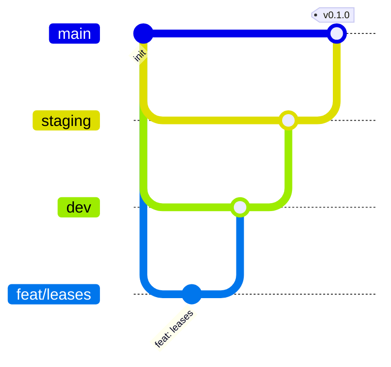

# Git workflow

## Branches

- `main`: production-ready. Protected; merges from `staging` only, via PR.
- `staging`: pre-production verification. Merges from `dev` via PR.
- `dev`: integration branch (default). Feature branches merge here via PR.
- `feat/*`, `fix/*`, `chore/*`, `docs/*`: short-lived, branched from `dev`.

Protections on `main` and `staging`: pull request required, CI must pass, no
force pushes.

## Commits

Conventional Commits, created with `pnpm commit` (Commitizen) and validated by
commitlint: `feat|fix|docs|style|refactor|perf|test|build|ci|chore|revert`,
header ≤ 100 characters. One logical change per commit.

## Hooks (Husky)

| Hook         | Runs                                                 |
| ------------ | ---------------------------------------------------- |
| `pre-commit` | lint-staged (ESLint --fix, Prettier) on staged files |
| `commit-msg` | commitlint                                           |
| `pre-push`   | `pnpm type-check` and `pnpm test`                    |

## CI (`.github/workflows/ci.yml`)

On pull requests and pushes to `dev`, `staging`, `main`: format check, lint,
type-check, test, build.
