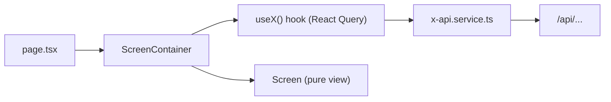
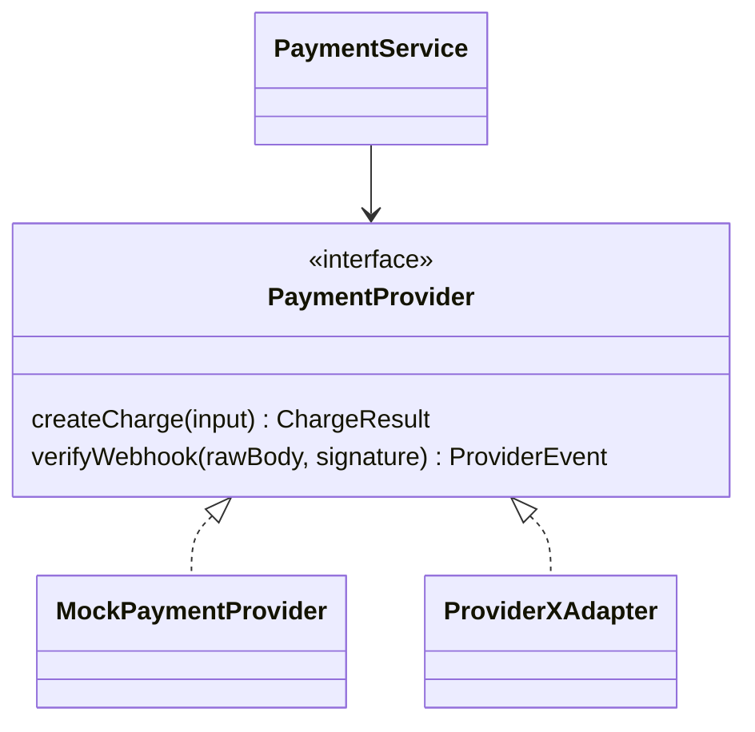
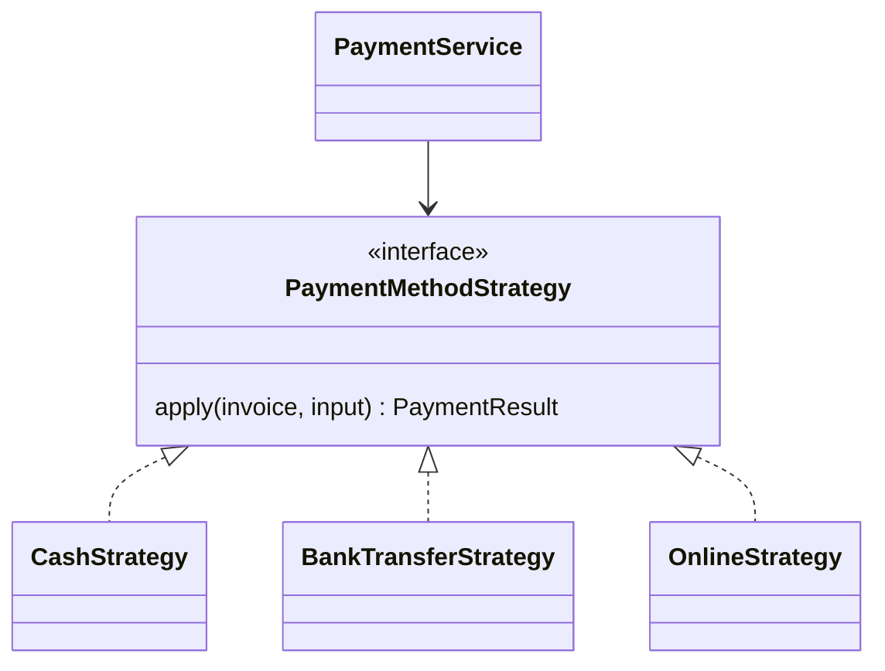

# Patterns

## Container / presentational

A screen is split in two. The **container** (`screens/<x>-screen-container.tsx`)
calls hooks (React Query, stores) and maps results to plain props. The **view**
(`screens/<x>-screen.tsx`) is pure: props in, markup out, no fetching, no state
access. `page.tsx` renders exactly one container.

Why: views are trivially testable and reusable; data rules live in one place.
Enforced: views cannot import React Query, services, stores or Supabase.
Reference: `modules/health/screens/`.

## Adapter

External systems sit behind an interface we own, so providers are swappable and
tests use a fake. Examples: `PaymentProvider` (online provider vs. a mock) and
`StorageAdapter` (Supabase Storage). Adapters live in `modules/<m>/adapters/`,
are the only code allowed to call `fetch` to a third party, validate provider
responses with zod, and convert money through `lib/billing.ts`.

## Strategy

Behaviour that varies by rule is a strategy selected at runtime instead of
nested `if/else`. Candidates: rent proration, late-fee calculation, and
payment-method handling (cash, bank transfer, online). Each strategy is a small
pure unit in `modules/<m>/strategies/`, covered by tests; money math inside
still goes through `lib/billing.ts`.

Concrete interfaces are finalised once the spec is known.
